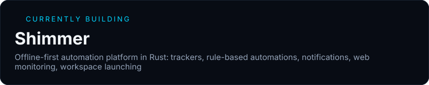

<!-- readme-aura source: edit THIS file, not README.md. The GitHub Action renders README.md from it. -->

<!-- Galaxy header (generated by galaxy-profile into assets/generated/) -->

  

  

## About me

* 🎓 Computer Engineering (Software Engineering Option) graduate, **Toronto Metropolitan University**, B.Eng (Hons), 2026
* 💼 **Software Developer Intern, SOTI**: AI chatbot SQL translation layer, backend services, Package Manager performance, iOS/Android install notifications
* 💼 **Software Developer Intern, TelHab** (Innovation Boost Zone): sole developer of a 10-page MVP portal for a physiotherapy wearable
* 🛠️ Strongest in **C# / .NET**, building in **Rust**, comfortable across **React**, **SQL**, **Docker**, and **Linux**

<!-- Animated "currently building" card, rendered to SVG by readme-aura -->

## Projects

  

| Project | What it is | Stack |
|---|---|---|
| [**Sakina AI**](https://github.com/Verifiedz/AI-Wellness-Platform) | Team-built AI wellness platform. I led the architecture: five decoupled microservices behind a YARP gateway, each with its own database, and built the real-time chat service. Locally hosted, QLoRA fine-tuned LLM served through Ollama. | C#, ASP.NET Core, SignalR, PostgreSQL, Redis, Docker, Azure |
| [**Shimmer**](https://github.com/Verifiedz/Shimmer) *(venture, in active development)* | Offline-first automation platform I'm building as my own venture: trackers, rule-based automations, notifications, web monitoring, workspace launching. Runs locally with no server or account, daemon-based backend with a plugin system, CI on Linux and macOS, 1,200 automated tests. Pre-launch. | Rust, SQLite |

## Tech stack

  

  

## GitHub stats

  

  

## Connect

  
  
  

